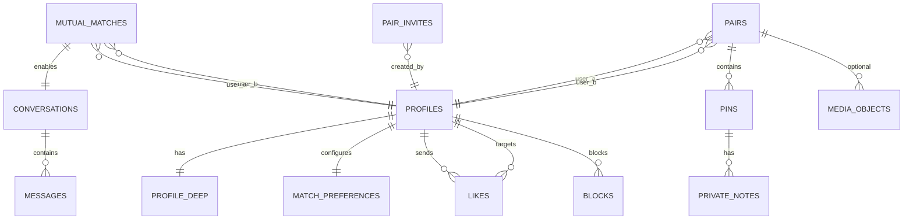

# DeepMatch — Database ERD

| Field | Value |
|---|---|
| Version | 1.0 |
| Status | Draft — maps Master logical ERD → live `public.*` |
| Owner | Database |
| Updated | 2026-10-11 |
| DDL | `supabase/migrations/20261011000000_init.sql` (+ follow-ups) |

## 1. Naming reconciliation

| Master logical | Live table | Notes |
|---|---|---|
| users | `auth.users` + `profiles` | Profile PK = auth uid |
| dating_preferences | `match_preferences` | |
| likes | `likes` | PK `(actor_id,target_id)` |
| matches / match_members | `mutual_matches` | Ordered `user_a < user_b` |
| conversations / members | `conversations` | Membership via mutual |
| messages | `messages` | Unique `(conversation_id, client_dedupe_key)` |
| couple_invitations | `pair_invites` | `code_hash`, expiry, status |
| couple_spaces / members | `pairs` | Two users; active unique index |
| memory_pins | `pins` | layers visited/wishlist/milestone |
| journal_entries | `private_notes` | Default not shared |
| memory_media | `media_objects` | |
| service_bookings / payments | `service_bookings` | Payments MISSING |
| reports / audit / outbox | `reports`, `audit_logs` | Outbox MISSING |

Logical Postgres schemas (`identity`, `dating`, …) are **not** created; single `public` schema for v1 (ADR-003 / existing).

## 2. Mermaid ERD (core)

## 3. Mandatory constraints (status)

| Constraint | Status |
|---|---|
| likes unique pair + no self | IMPLEMENTED_VERIFIED |
| mutual unique ordered pair | IMPLEMENTED_VERIFIED |
| messages client dedupe unique | IMPLEMENTED_VERIFIED (nullable key caveat) |
| invite token hashed + expiry | IMPLEMENTED_VERIFIED (`code_hash`) |
| max 2 members / one active pair per user pair | PARTIAL (pair uniqueness; single-active-membership-per-user TBD) |
| payments unique provider ref | MISSING |
| outbox event uniqueness | MISSING |

## 4. Migration strategy

- Forward-only SQL in `supabase/migrations/`.
- Never destructive prod migrate without Founder + backup evidence.
- New Master entities (outbox, payments) = new timestamped migrations after ADR.
