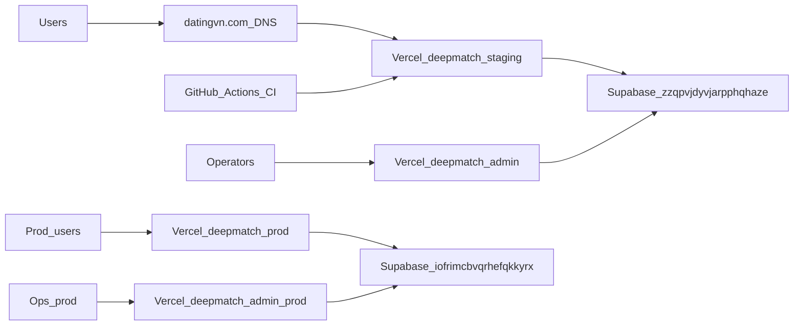

# DeepMatch — Deployment Topology

| Field | Value |
|---|---|
| Version | 1.1 |
| Status | Active |
| Owner | DevOps |
| Updated | 2026-10-12 |

## Topology

## Projects

| Component | Provider | ID / URL |
|---|---|---|
| Web staging | Vercel `tradingbase/deepmatch` | https://datingvn.com |
| Admin staging | Vercel `deepmatch-admin` | https://deepmatch-admin.vercel.app |
| DB staging | Supabase ap-southeast-1 | `zzqpvjdyvjarpphqhaze` |
| Web prod | Vercel `deepmatch-prod` | https://deepmatch-prod.vercel.app |
| Admin prod | Vercel `deepmatch-admin-prod` | https://deepmatch-admin-prod.vercel.app |
| DB prod | Supabase `deepmatch-prod` | `iofrimcbvqrhefqkkyrx` |
| Repo | GitHub | `leekyengah/deepmatch` |
| CI | GitHub Actions | `.github/workflows/ci.yml` |
| Prod runbook | `docs/ops/PRODUCTION.md` | — |
| Mobile iOS | Expo EAS `apps/mobile` | bundle `com.datingvn.deepmatch` — `docs/ops/APP_STORE.md` |

## DNS

- Apex A → `216.150.1.1` (recommend also `216.150.16.1`)
- www CNAME → `e34d2819c4f1efcd.vercel-dns-016.com`
- NS remain Matbao; configuredBy A on Vercel
- TLS: Let's Encrypt via Vercel certs

## Pipeline

1. PR → lint + typecheck + unit + build + secrets guard  
2. Merge → deploy Vercel (staging)  
3. Production: dedicated projects (`deepmatch-prod` / `deepmatch-admin-prod`); `NEXT_PUBLIC_APP_ENV=production` → health `productionDeploy=true`
4. DNS cutover of apex to prod is optional — see `docs/ops/PRODUCTION.md`

## Config

- Root `vercel.json` for web monorepo build
- `vercel.admin.json` for admin / `vercel.prod.json` for prod web
- Env: `NEXT_PUBLIC_*`, Supabase keys server-only; never commit `.env.local` or `.ai/prod.env.ps1`

## Feature flags

`ff_matching`, `ff_chat`, `ff_media_upload`, `ff_concierge`, `ff_discovery`, `ff_premium`, `ff_billing` — DB + env override.
