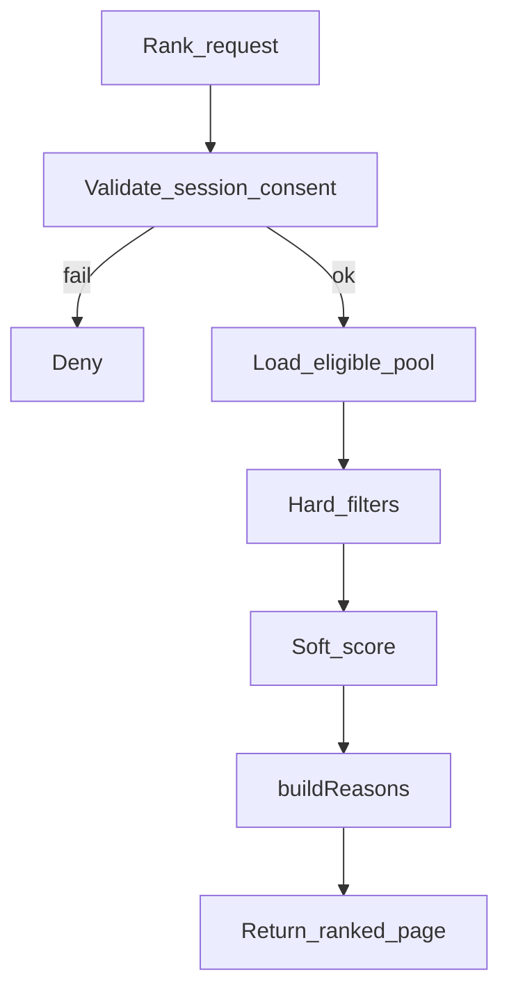

# DeepMatch — Matching Engine

| Field | Value |
|---|---|
| Version | 1.0 |
| Status | Draft — rule-based v1 |
| Owner | Matching |
| Updated | 2026-10-11 |
| Code | `packages/shared/src/matching/` |
| ADR | Master ADR-006 ↔ repo ADR-05 (open weights) |

## Principles

- No EQ auto-score, no love-probability claims.
- Hard filters before soft ranking; explainable `reasons[]`.
- Forbidden signals: private diary, exact GPS, advisor notes, love probability (`FORBIDDEN_RANK_SIGNALS`).

## Pipeline

## Hard filters \(E(u,v)\)

Implemented in `passesHardFilters`:

- discovery opt-in / not hidden
- age ≥ 18 and within viewer min/max
- not self; not in `excludedUserIds` (blocks)
- region intersection when configured
- required goals subset

## Soft ranking \(R(u,v)\)

Weighted sum (current weights in code): interests×3, values×4, goals×5, same region+2, dealbreaker hit−10. Not yet loaded from `matching_rule_versions` (PARTIAL).

## Cold start

- Do not fabricate profiles.
- Expand soft criteria only with user consent (product); keep hard filters.
- Concierge matching behind `ff_concierge`.

## KPIs (measurement plan)

| KPI | Status |
|---|---|
| Eligible Candidate Rate | NOT_RUN |
| Mutual Match Rate | NOT_RUN |
| First Conversation Rate | NOT_RUN |
| Confirmed Date Rate | NOT_RUN |
| Safety Report Rate | NOT_RUN |
| Recommendation Latency p95 | NOT_RUN |

## Tests

- Unit: `packages/shared/src/matching/engine.test.ts` — PASS locally via `npm test`.
- Golden cases / forbidden-signal asserts — PARTIAL.
