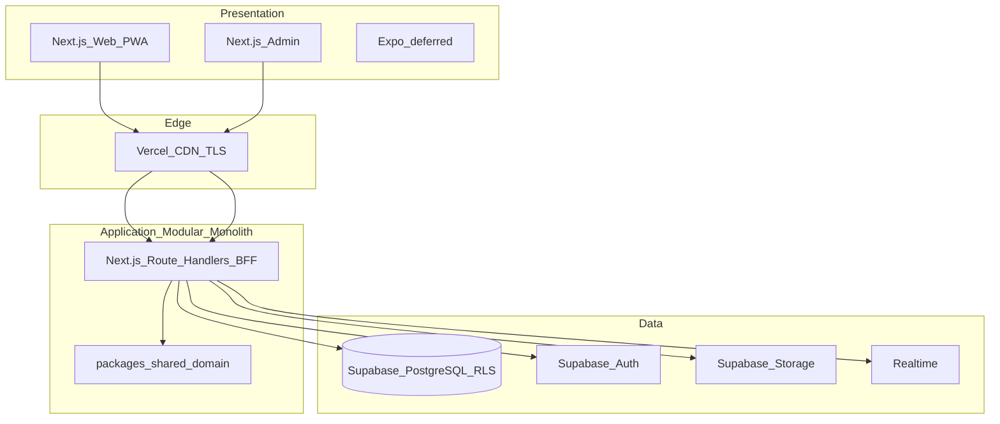

# DeepMatch — System Architecture

| Field | Value |
|---|---|
| Version | 1.0 |
| Status | Draft — Architecture Contract (reconciled with repo) |
| Owner | Engineering |
| Updated | 2026-10-11 |
| Commit baseline | `f2a50c8` (master) |

## 1. Product pillars

Three integrated products in one app: **Tìm nhau** (discover/match/chat), **Chúng mình** (couple space/map/journals), **Đồng hành** (concierge). Launch controlled by feature flags.

## 2. Logical architecture

## 3. Technology (Accepted ADR)

| Layer | Choice | Evidence |
|---|---|---|
| Web / Admin | Next.js App Router | `apps/web`, `apps/admin` |
| Domain logic | TypeScript `packages/shared` | matching, chat ACL, age |
| Backend style | Modular monolith BFF (no NestJS) | Route Handlers under `apps/web/src/app/api` |
| DB / Auth / Storage / Realtime | Supabase | `supabase/migrations`, project `zzqpvjdyvjarpphqhaze` |
| Maps | Mapbox | ADR-02 / ADR-08 |
| Hosting | Vercel team `tradingbase` | `datingvn.com`, staging `*.vercel.app` |
| Mobile | In progress (App Store MVP) | `apps/mobile` Expo Router → `/api/v1` + Apple IAP |

## 4. Module map (M01–M16 → code)

| Module | Status | Primary location |
|---|---|---|
| M01 Identity | PARTIAL | Supabase Auth + profile trigger |
| M02 Deep Profile | PARTIAL | `GET/PATCH /api/v1/me/profile` + UI |
| M03 Discovery | PARTIAL | `GET /api/v1/discovery/candidates` |
| M04 Matching | IMPLEMENTED_VERIFIED (unit) | `packages/shared/src/matching` |
| M05 Interaction | PARTIAL | `POST /api/v1/likes` |
| M06 Messaging | PARTIAL | `GET/POST /api/v1/messages` + RLS |
| M07 Couple Lifecycle | PARTIAL | invites/accept + `POST .../disconnect` |
| M08 Memory Map | PARTIAL | `GET/POST /api/v1/couples/{id}/pins` |
| M09 Private Journals | PARTIAL | `GET/POST .../journals` + RLS |
| M10 Wishlists | PARTIAL | pin layer `wishlist` |
| M11 Concierge | PARTIAL / flagged off | bookings tables; `ff_concierge=false` |
| M12 Billing | MISSING / deferred | ADR-09 |
| M13 Trust & Safety | PARTIAL | `POST /api/v1/reports` + blocks schema |
| M14 Notifications | MISSING | outbox table ready; workers TBD |
| M15 Admin | PARTIAL | `apps/admin`, `admin_roles` |
| M16 Analytics | MISSING | — |

## 5. Environments

| Env | URL / ref | Notes |
|---|---|---|
| Local | localhost:3000 | `.env.local` gitignored |
| Staging | https://deepmatch-eight.vercel.app | Also https://datingvn.com |
| Admin staging | https://deepmatch-admin.vercel.app | |
| Production | Dedicated project live | `deepmatch-prod` health `productionDeploy=true`; apex DNS still staging until cutover |

## 6. Non-goals (v1)

Kubernetes, Kafka, Elasticsearch, microservices split, NestJS rewrite, automated love-probability scoring. (Expo App Store MVP scaffolded; Couple/Admin parity deferred.)
