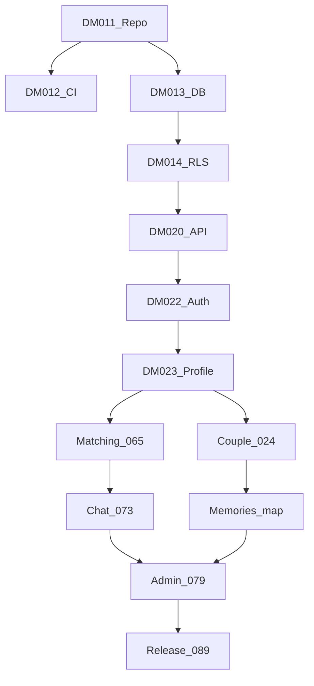

# DeepMatch — Execution Backlog (reconciled with DM-001–090)

| Field | Value |
|---|---|
| Version | 1.0 |
| Status | Draft |
| Owner | Engineering |
| Updated | 2026-10-11 |
| Rule | Do not overwrite Master Sheet states without evidence + authorization |

## Priority waves

| Order | DM group | Focus | Exit criteria |
|---|---|---|---|
| 1 | DM-011–014 + ARCH-01…04 | Repo, CI, ERD, RLS evidence | CI green + RLS deny PASS |
| 2 | DM-015–020 | UX tokens, OpenAPI | Spec approved + contract tests |
| 3 | DM-021–023 | Shell, Auth, onboarding | Auth E2E PASS |
| 4 | DM-024–040 | Couple invite, memories, map | Couple privacy E2E PASS |
| 5 | DM-059–064 | Personal settings | Account/privacy E2E |
| 6 | DM-065–072 | Matching/discovery/likes | MATCH-* tests PASS |
| 7 | DM-073–078 | Messaging | CHAT-* PASS |
| 8 | DM-079–088 | Admin/moderation | RBAC/audit PASS |
| 9 | Concierge/billing | M11–M12 | Workflow PASS; billing ADR |
| 10 | DM-048–058, 089–090 | QA/release | Human G7 |

## Architecture subtasks

| Subtask | Parent | Deliverable | Status |
|---|---|---|---|
| ARCH-01 | DM-011 | Inventory + dependency map | DONE (baseline audit) |
| ARCH-02 | DM-013 | ERD + migration strategy | DONE (docs); schema evolve ongoing |
| ARCH-03 | DM-014 | RLS matrix + deny tests | HARNESS_READY; live deny needs JWTs |
| ARCH-04 | DM-020 | OpenAPI v1 | DONE (`openapi/openapi.v1.yaml` + `/api/v1`) |
| MATCH-01…03 | DM-065–072 | Eligibility/scoring/explain | PARTIAL (unit PASS) |
| CHAT-01…02 | DM-073–078 | Idempotency + revoke | PARTIAL |
| COUPLE-01…02 | DM-024–040 | State machine + journal policy | PARTIAL |
| SEC-01…02 | DM-014 / 089 | Threat model + adversarial | PARTIAL / NOT_RUN |
| OPS-01…02 | DM-012 / 089 | Observability + DR | MISSING |

## Module → next code actions

| Module | Next implementation |
|---|---|
| M05/M04 | `/api/v1` likes/rank envelope; discovery candidates |
| M07 | `POST /api/v1/couples/{id}/disconnect` |
| M08/M09 | pins + journals REST |
| M13 | `POST /api/v1/reports` |
| M14/M16 | after outbox migration |
| M12 | blocked on ADR-09 |

## Dependency graph (short)

## Rollback defaults

- Feature flag off for domain.
- Vercel redeploy previous.
- Forward-fix migration with compensating migration (no prod drop).
